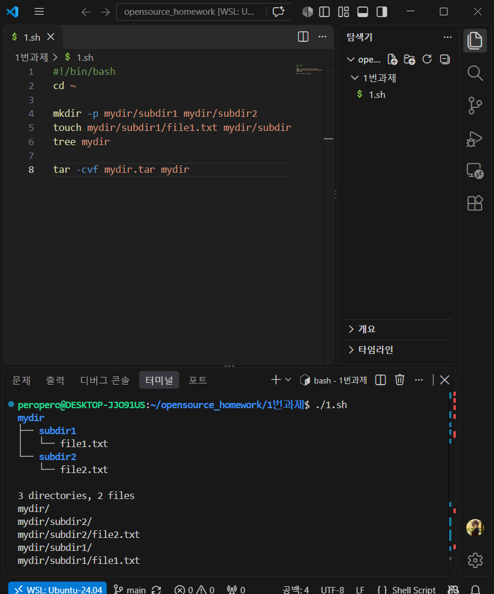
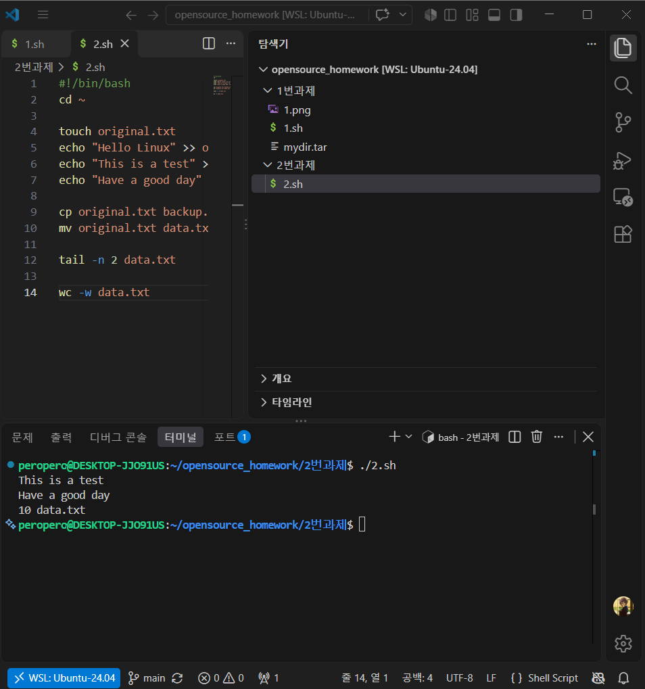
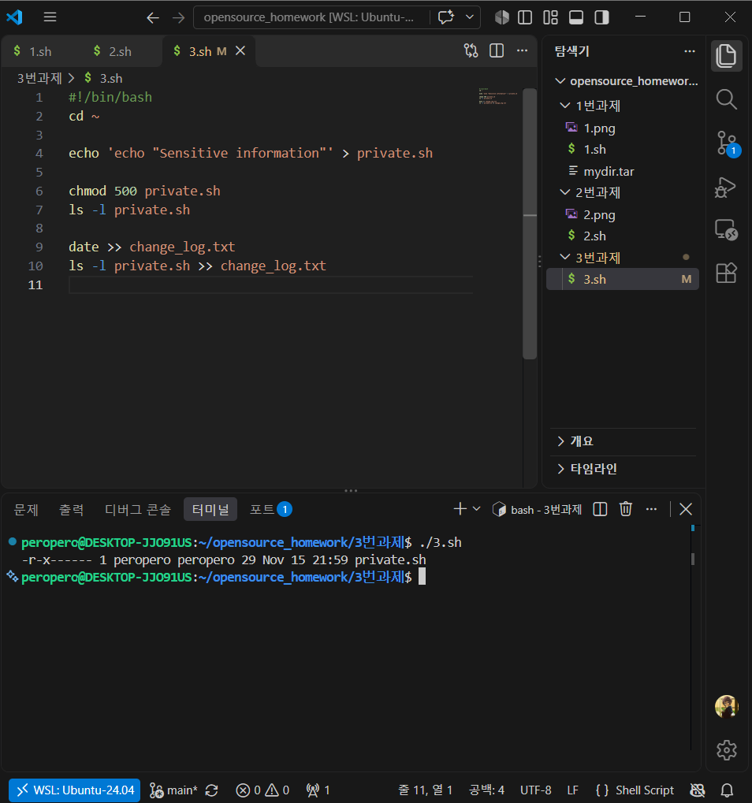
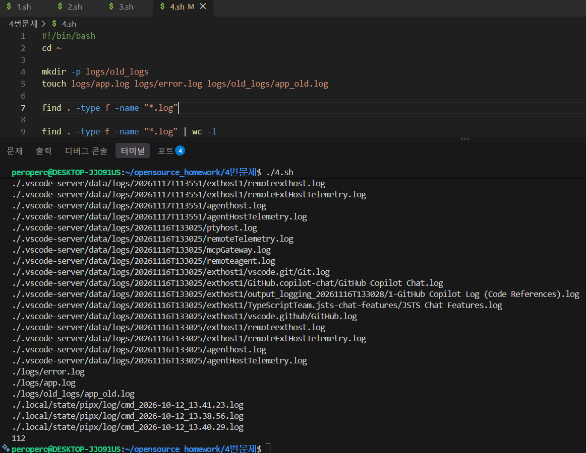
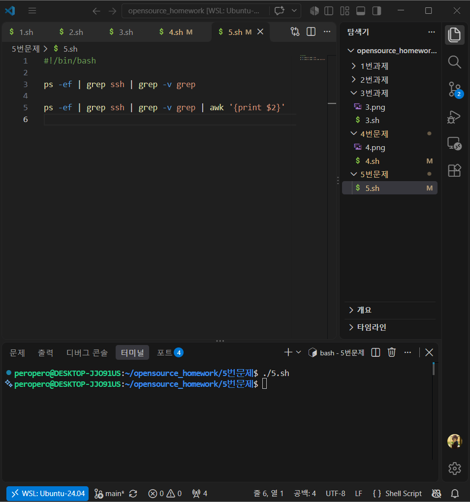

# opensource_homework

오픈소스SW 개론 수업에서 진행한 Git & GitHub 과제를 정리한 저장소입니다.
<br>
<br>
본 과제의 셸 스크립트와 README.md는 생성형 AI를 사용하지 않고 직접 작성하였습니다.

### 이 스크립트들은 Ubuntu-24.04 (WSL2) 환경에서 작성되었습니다.
모든 스크립트(`1.sh` ~ `5.sh`)는 작업 환경의 일관성을 유지하여서 작성하였습니다.
</br>
</br>

### 목차
1. [1번 과제 - 디렉터리 구조 생성 및 tar 압축](#1번-과제---디렉터리-구조-생성-및-tar-압축)
2. [2번 과제 - 파일 내용 추가 및 tail, wc 활용](#2번-과제---파일-내용-추가-및-tail-wc-활용)
3. [3번 과제 - 파일 권한 설정 및 변경 이력 기록](#3번-과제---파일-권한-설정-및-변경-이력-기록)
4. [4번 과제 - 로그 파일 생성 및 find 검색](#4번-과제---로그-파일-생성-및-find-검색)
5. [5번 과제 - 프로세스 필터링 및 PID 추출](#5번-과제---프로세스-필터링-및-pid-추출)

- - -

## 1번 과제 - 디렉터리 구조 생성 및 tar 압축
<br>

홈 디렉터리(`~`)에 계층형 디렉터리 및 빈 파일을 생성한 뒤 트리 구조로 검증하고, 전체 디렉터리를 `.tar` 아카이브 파일로 압축하는 스크립트입니다.

```bash
#!/bin/bash
cd ~

mkdir -p mydir/subdir1 mydir/subdir2
touch mydir/subdir1/file1.txt mydir/subdir2/file2.txt
tree mydir

tar -cvf mydir.tar mydir
```
<br>

&nbsp;&nbsp;&nbsp;&nbsp;1) <b>디렉터리 및 파일 계층 생성 :</b> <code>mkdir -p</code> 옵션을 사용하여 상위 디렉터리(<code>mydir</code>)와 하위 디렉터리(<code>subdir1</code>, <code>subdir2</code>)를 한 번에 생성하고, <code>touch</code> 명령어로 각 하위 폴더 안에 <code>file1.txt</code>와 <code>file2.txt</code>를 생성합니다.
<br>
<br>
&nbsp;&nbsp;&nbsp;&nbsp;2) <b>구조 확인 및 아카이브 압축 :</b> <code>tree mydir</code> 명령어로 생성된 계층 구조를 시각적으로 검증한 뒤, 추가 요구사항에 따라 <code>tar -cvf mydir.tar mydir</code> 명령어를 실행해 <code>mydir</code> 전체를 단일 아카이브 파일로 묶습니다.
<br>
<br>
&nbsp;&nbsp;&nbsp;&nbsp;

- - -

## 2번 과제 - 파일 내용 추가 및 tail, wc 활용
<br>

텍스트 파일을 생성하여 리다이렉션으로 여러 줄의 문장을 누적 기록하고, 특정 줄 추출 및 전체 단어 수를 계산하는 스크립트입니다.

```bash
#!/bin/bash
cd ~

touch data.txt
echo "Hello Linux" >> data.txt
echo "This is a test" >> data.txt
echo "Have a good day" >> data.txt

tail -n 2 data.txt
wc -w data.txt
```
<br>

&nbsp;&nbsp;&nbsp;&nbsp;1) <b>파일 생성 및 내용 누적 추가 :</b> <code>touch data.txt</code>로 빈 파일을 생성한 뒤, 덮어쓰기(<code>></code>)가 아닌 리다이렉션(<code>>></code>)을 사용하여 세 줄의 문장(<code>Hello Linux</code>, <code>This is a test</code>, <code>Have a good day</code>)을 기존 내용 뒤에 차례대로 이어 붙입니다.
<br>
<br>
&nbsp;&nbsp;&nbsp;&nbsp;2) <b>하위 줄 출력 및 단어 수 계산 :</b> 추가 요구사항에 따라 <code>tail -n 2 data.txt</code> 명령어로 파일의 마지막 두 줄(<code>This is a test</code>, <code>Have a good day</code>)만 출력하고, <code>wc -w data.txt</code> 명령어로 파일 전체에 포함된 총 단어 수(<code>9</code>)를 계산하여 출력합니다.
<br>
<br>
&nbsp;&nbsp;&nbsp;&nbsp;
<br>
<br>

> [!CAUTION]
> <code>>></code> 연산자는 기존 파일의 맨 끝에 내용을 이어서 추가하므로, <code>2.sh</code>를 여러 번 반복 실행하면 문장이 누적되어 단어 수가 증가합니다. 

- - -

## 3번 과제 - 파일 권한 설정 및 변경 이력 기록
<br>

리다이렉션으로 스크립트 파일을 생성한 뒤 소유자 전용으로 접근 권한을 제한하고, 권한 변경 시각과 상세 속성 이력을 로그 파일에 기록하는 스크립트입니다.

```bash
#!/bin/bash
cd ~

echo "Sensitive information" > private.sh
chmod 500 private.sh

date >> change_log.txt
ls -l private.sh >> change_log.txt
```
<br>

&nbsp;&nbsp;&nbsp;&nbsp;1) <b>리다이렉션을 이용한 파일 생성 :</b> 리다이렉션(<code>></code>)을 사용하여 <code>private.sh</code> 파일 생성과 동시에 <code>Sensitive information</code> 문자열을 기록합니다.
<br>
<br>
&nbsp;&nbsp;&nbsp;&nbsp;2) <b>접근 권한 제한 (<code>chmod 500</code>) :</b> 8진수 권한 표기법을 이용해 소유자에게만 읽기(<code>4</code>)와 실행(<code>1</code>) 권한을 부여하고, 그룹 및 기타 사용자의 모든 권한을 제거(<code>0</code>)하여 <code>-r-x------</code> 상태로 설정합니다.
<br>
<br>
&nbsp;&nbsp;&nbsp;&nbsp;3) <b>변경 이력 로그 누적 기록 :</b> 추가 요구사항에 따라 <code>date</code> 명령어로 권한 변경 시점의 시스템 시각을 기록하고, <code>ls -l private.sh</code> 명령어로 변경된 권한 속성을 확인한 결과를 모두 <code>>></code> 연산자로 <code>change_log.txt</code>에 누적 저장합니다.
<br>
<br>
&nbsp;&nbsp;&nbsp;&nbsp;
<br>
<br>

> [!CAUTION]
> <code>3.sh</code> 실행 후에는 <code>private.sh</code>의 쓰기(<code>w</code>) 권한이 제거(<code>-r-x------</code>)되므로, 스크립트를 두 번 이상 연속 실행할 경우 <code>private.sh: Permission denied</code> 오류가 발생합니다.

- - -

## 4번 과제 - 로그 파일 생성 및 find 검색
<br>

중첩 디렉터리 구조 안에 여러 개의 `.log` 파일을 생성한 뒤, 홈 디렉터리 전체에서 특정 확장자를 가진 파일을 재귀적으로 탐색하고 개수를 집계하는 스크립트입니다.

```bash
#!/bin/bash
cd ~

mkdir -p logs/old_logs
touch logs/app.log logs/error.log logs/old_logs/app_old.log

find . -type f -name "*.log"
find . -type f -name "*.log" | wc -l
```
<br>

&nbsp;&nbsp;&nbsp;&nbsp;1) <b>로그 디렉터리 및 샘플 파일 생성 :</b> <code>mkdir -p logs/old_logs</code>로 상위 및 하위 로그 디렉터리를 생성하고, <code>logs/app.log</code>, <code>logs/error.log</code>, <code>logs/old_logs/app_old.log</code> 총 3개의 빈 로그 파일을 생성합니다.
<br>
<br>
&nbsp;&nbsp;&nbsp;&nbsp;2) <b>와일드카드 검색 및 파이프(<code>|</code>) 개수 집계 :</b> <code>find . -type f -name "*.log"</code> 명령어로 홈 디렉터리(<code>~</code>) 하위의 모든 일반 파일(<code>-type f</code>) 중 이름이 <code>.log</code>로 끝나는 파일 경로를 전부 출력하고, 파이프(<code>|</code>)로 <code>wc -l</code> 명령어를 연결해 검색된 총 파일 개수를 출력합니다.
<br>
<br>
&nbsp;&nbsp;&nbsp;&nbsp;
<br>
<br>

> [!CAUTION]
> 지시사항에 따라 홈 디렉터리(<code>~</code>) 전체를 탐색하기 때문에 직접 생성한 <code>logs/</code> 내부의 3개 파일 외에도 WSL 원격 개발 환경에서 자동 생성된 내부 로그 파일들이 함께 검색되어 총 개수가 3개보다 많이 출력됩니다.

- - -

## 5번 과제 - 프로세스 필터링 및 PID 추출
<br>

시스템에서 실행 중인 전체 프로세스를 조회한 뒤 파이프라인과 텍스트 처리 도구를 조합하여 특정 프로세스 정보와 PID(Process ID)만 추출하는 스크립트입니다.

```bash
#!/bin/bash

ps -ef | grep ssh | grep -v grep
ps -ef | grep ssh | grep -v grep | awk '{print $2}'
```
<br>

&nbsp;&nbsp;&nbsp;&nbsp;1) <b>프로세스 필터링 및 자기 자신 제외 :</b> <code>ps -ef</code>로 현재 실행 중인 모든 프로세스의 상세 목록을 출력한 뒤 <code>grep ssh</code>로 <code>ssh</code> 관련 프로세스를 필터링하고, <code>grep -v grep</code>을 한 번 더 연결하여 검색 명령어 자기 자신의 프로세스가 결과에 포함되는 것을 제외합니다.
<br>
<br>
&nbsp;&nbsp;&nbsp;&nbsp;2) <b><code>awk</code>를 이용한 PID 필드 추출 :</b> 추가 요구사항에 따라 필터링된 표준 출력을 파이프(<code>|</code>)로 <code>awk '{print $2}'</code>에 전달하여, 공백으로 구분된 전체 프로세스 정보 중 두 번째 열(<code>$2</code>)에 위치한 PID 번호만 별도로 추출해 출력합니다.
<br>
<br>
&nbsp;&nbsp;&nbsp;&nbsp;
<br>
<br>

> [!CAUTION]
> 기본 WSL2 Ubuntu 환경에서는 백그라운드 SSH 프로세스가 실행 중이지 않아 아무것도 출력되지 않았습니다.

- - -

## 면책조항

이 소프트웨어는 어떠한 종류의 명시적 또는 묵시적 보증 없이
**"있는 그대로(AS IS)"** 제공됩니다.

`opensource_homework`는 오픈소스SW 개론 수업의 Git & Github과제를 수행하기 위해 작성된 학습용 코드 저장소입니다.

프로젝트 작성자는 다음 사항을 보장하지 않습니다.

* 모든 리눅스 배포판 및 쉘 환경에서 동일한 출력 결과가 나타나는 것
* 스크립트 실행 중 홈 디렉터리 내 기존 파일과 이름이 중복되지 않는 것
* 모든 실행 환경에서 오류 없이 작동하는 것


이 저장소의 스크립트 사용으로 발생하는 데이터 손실, 권한 변경 또는
기타 결과에 대한 책임은 사용자 본인에게 있습니다.